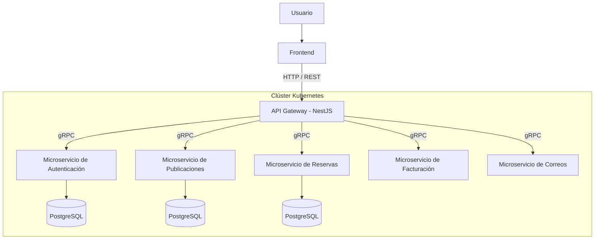

# BMBair — Plataforma de Reservas con Arquitectura de Microservicios

**Proyecto Full Stack | Arquitectura de Sistemas Distribuidos | Kubernetes | gRPC**

BMBair es una plataforma web de publicación y reserva de alojamientos, desarrollada individualmente bajo una **arquitectura distribuida de microservicios**, integrando frontend, API Gateway, servicios backend, bases de datos y orquestación de contenedores.

El proyecto fue realizado en el contexto de la asignatura de Arquitectura de Sistemas, con el objetivo de diseñar e implementar una solución modular, desacoplada y preparada para evolucionar mediante servicios independientes.

El desarrollo abarcó todas las capas del sistema, desde la interfaz de usuario hasta el despliegue de los componentes en un clúster local de Kubernetes.

## Tecnologías utilizadas

| Categoría | Tecnologías |
|---|---|
| Backend | NestJS, Node.js, Java, Spring Boot |
| API Gateway | NestJS |
| Comunicación | REST API, gRPC, Protocol Buffers |
| Bases de datos | PostgreSQL |
| Autenticación | JWT |
| Contenerización | Docker |
| Orquestación | Kubernetes |
| Gestión de despliegues | Helm |
| Entorno de infraestructura | Docker Desktop, Kubernetes local |

## Arquitectura del sistema

BMBair implementa una arquitectura de microservicios, donde las responsabilidades del negocio se distribuyen entre componentes independientes.

El **API Gateway**, desarrollado con NestJS, funciona como punto de entrada de la plataforma, recibiendo las solicitudes del frontend y coordinando la comunicación con los microservicios mediante gRPC.

La separación de responsabilidades permite mantener una estructura modular, facilitando el mantenimiento y la evolución de cada componente.

### Diagrama de arquitectura



*Diagrama conceptual de los principales componentes de la arquitectura. La organización exacta de los servicios y sus bases de datos depende de la configuración del despliegue.*

## Componentes principales

### 1. Frontend

Interfaz web encargada de permitir la interacción de los usuarios con las funcionalidades de la plataforma.

Responsabilidades:

- Presentación de publicaciones de alojamientos.
- Interacción con las funcionalidades de reservas.
- Gestión de formularios y navegación.
- Consumo de los endpoints REST del API Gateway.
- Presentación de la información recibida desde el backend.

### 2. API Gateway

Desarrollado con **NestJS**, actúa como punto de entrada centralizado para las solicitudes del frontend.

Responsabilidades:

- Exponer endpoints REST.
- Recibir y procesar solicitudes HTTP.
- Comunicarse con los microservicios mediante gRPC.
- Centralizar el acceso a las funcionalidades del sistema.
- Integrar los mecanismos de autenticación.

Esta capa permite desacoplar el frontend de las implementaciones internas de los microservicios.

### 3. Microservicio de publicaciones

Desarrollado utilizando **Java y Spring Boot**, se encarga de gestionar la información relacionada con los alojamientos publicados.

Entre sus operaciones gRPC se encuentran:

| Operación | Descripción |
|---|---|
| `CreatePublication` | Crear una publicación |
| `GetPublicationById` | Obtener una publicación por identificador |
| `GetAllPublications` | Obtener el listado de publicaciones |

### 4. Microservicio de reservas

Responsable de gestionar las operaciones relacionadas con las reservas de alojamientos.

Sus principales responsabilidades incluyen:

- Registrar reservas.
- Consultar información de reservas.
- Procesar solicitudes recibidas mediante gRPC.
- Gestionar la información correspondiente a su dominio.

### 5. Servicios complementarios

La arquitectura también contempla componentes asociados a otras responsabilidades del negocio:

- **Autenticación:** gestión de usuarios y acceso a la plataforma.
- **Facturación:** procesamiento de funcionalidades relacionadas con facturación.
- **Correos electrónicos:** gestión del envío de notificaciones.

La separación de estas responsabilidades permite reducir el acoplamiento entre los componentes.

## Comunicación mediante gRPC

Uno de los aspectos centrales del proyecto fue la implementación de comunicación entre microservicios mediante **gRPC (Google Remote Procedure Call)**.

Esta tecnología utiliza HTTP/2 y Protocol Buffers para definir interfaces de comunicación y serializar mensajes.

### ¿Por qué gRPC?

- Permite comunicación entre servicios desarrollados en diferentes lenguajes.
- Utiliza contratos tipados definidos mediante archivos `.proto`.
- Emplea serialización binaria con Protocol Buffers.
- Facilita la definición de interfaces de comunicación entre componentes.
- Permite separar los contratos de las implementaciones de cada servicio.

### Ejemplo de operaciones

El microservicio de publicaciones expone operaciones como:

```text
PublicationService
    |
    |-- CreatePublication
    |-- GetPublicationById
    |-- GetAllPublications
```

Los contratos de comunicación permiten que el API Gateway y los microservicios intercambien información sin depender directamente de sus implementaciones internas.

## Contenerización con Docker

Los componentes del sistema fueron contenerizados utilizando Docker, permitiendo empaquetar las aplicaciones junto con sus dependencias.

La contenerización facilita:

- Aislar los entornos de ejecución.
- Mantener configuraciones consistentes.
- Desplegar aplicaciones de diferentes tecnologías.
- Integrar los componentes con Kubernetes.
- Simplificar la administración de dependencias.

## Orquestación con Kubernetes

La infraestructura fue desplegada sobre un **clúster local de Kubernetes utilizando Docker Desktop**.

Kubernetes se utilizó para administrar los componentes contenerizados y proporcionar mecanismos de comunicación, configuración y persistencia.

### Recursos utilizados

| Recurso | Función |
|---|---|
| Deployment | Gestionar los pods de las aplicaciones |
| Pod | Ejecutar los contenedores |
| Service | Permitir la comunicación entre componentes |
| ClusterIP | Exponer servicios dentro del clúster |
| NodePort | Permitir el acceso externo al API Gateway |
| PersistentVolumeClaim | Solicitar almacenamiento persistente |
| Helm | Gestionar configuraciones y despliegues |

### Configuración de servicios

Entre los servicios configurados en Kubernetes se encuentran:

| Servicio | Tipo | Puerto |
|---|---|---|
| `k8s-apigateway` | NodePort | 3000 / 32392 |
| `k8s-ms-publication` | ClusterIP | 50051 |
| `k8s-db-publication` | ClusterIP | 5432 |

El API Gateway se expone mediante NodePort, mientras que los microservicios y las bases de datos utilizan servicios internos para comunicarse dentro del clúster.

### Persistencia

Para PostgreSQL se configuró almacenamiento persistente mediante Kubernetes.

Uno de los recursos utilizados fue:

```yaml
kind: PersistentVolumeClaim
metadata:
  name: postgres-pvc
spec:
  accessModes:
    - ReadWriteOnce
  resources:
    requests:
      storage: 1Gi
```

Este mecanismo permite conservar los datos almacenados independientemente del ciclo de vida de los pods, siempre que el volumen persistente permanezca disponible.

## Gestión de bases de datos

La plataforma utiliza **PostgreSQL** como motor de bases de datos relacionales.

La arquitectura sigue un enfoque de separación de responsabilidades, donde los microservicios gestionan la información correspondiente a su dominio.

Entre los beneficios de este diseño se encuentran:

- Menor acoplamiento entre servicios.
- Separación de responsabilidades.
- Mayor independencia en el mantenimiento.
- Posibilidad de evolucionar los modelos de datos de cada componente.

## Desarrollo individual y responsabilidades

BMBair fue un **proyecto desarrollado íntegramente de manera individual**.

Fui responsable del diseño, implementación, integración y despliegue de todos los componentes de la plataforma, abordando tanto el desarrollo de software como la configuración de la infraestructura.

### Mis responsabilidades

**Desarrollo frontend**
- Implementación de la interfaz web.
- Integración con el API Gateway.
- Gestión de la interacción del usuario con las funcionalidades del sistema.

**Desarrollo backend**
- Implementación del API Gateway con NestJS.
- Desarrollo de microservicios.
- Integración de servicios desarrollados con Node.js y Java.
- Implementación de operaciones y lógica de negocio.

**Comunicación entre servicios**
- Definición de contratos mediante Protocol Buffers.
- Configuración de comunicación gRPC.
- Integración entre el API Gateway y los microservicios.

**Persistencia**
- Configuración de bases de datos PostgreSQL.
- Integración de la persistencia con los servicios.
- Configuración de almacenamiento persistente en Kubernetes.

**Infraestructura**
- Contenerización de aplicaciones con Docker.
- Configuración del clúster local de Kubernetes.
- Creación y administración de Deployments y Services.
- Configuración de redes y puertos.
- Gestión de recursos y despliegues mediante Helm.

**Integración y pruebas**
- Verificación de la comunicación entre componentes.
- Diagnóstico de errores de conectividad.
- Resolución de problemas de configuración gRPC.
- Validación de la integración entre frontend, gateway, microservicios y bases de datos.

## Desafíos técnicos

Durante el desarrollo se abordaron diferentes desafíos relacionados con la integración de sistemas distribuidos.

### Comunicación entre diferentes tecnologías

La integración de servicios desarrollados con NestJS y Spring Boot requirió definir contratos compatibles mediante Protocol Buffers y configurar correctamente la comunicación gRPC.

### Comunicación dentro de Kubernetes

Fue necesario comprender y configurar el descubrimiento de servicios, los puertos internos y la exposición del API Gateway.

### Persistencia de información

Se implementó almacenamiento persistente para evitar la pérdida de información ante la recreación de los pods de bases de datos.

### Integración de múltiples componentes

El sistema requirió coordinar frontend, gateway, microservicios, bases de datos y recursos de Kubernetes, manteniendo la separación de responsabilidades de cada componente.

## Aprendizajes

El desarrollo de BMBair permitió aplicar conceptos de arquitectura de software y sistemas distribuidos en un proyecto integral.

Los principales aprendizajes fueron:

- Diseño e implementación de arquitecturas de microservicios.
- Desarrollo full stack.
- Integración de tecnologías heterogéneas.
- Comunicación síncrona mediante gRPC.
- Definición de contratos con Protocol Buffers.
- Contenerización de aplicaciones con Docker.
- Despliegue y administración de Kubernetes.
- Configuración de redes y servicios internos.
- Gestión de persistencia en entornos contenerizados.
- Diagnóstico y resolución de problemas de integración.

## Contexto académico

| Característica | Descripción |
|---|---|
| Proyecto | BMBair |
| Asignatura | Arquitectura de Sistemas |
| Tipo | Proyecto académico individual |
| Área | Desarrollo Full Stack y Sistemas Distribuidos |
| Arquitectura | Microservicios |
| Comunicación | REST y gRPC |
| Infraestructura | Docker y Kubernetes |
| Base de datos | PostgreSQL |
| Entorno de despliegue | Kubernetes local |

## Conclusión

BMBair representa una implementación integral de una plataforma web basada en microservicios, desde la construcción de la interfaz de usuario hasta la configuración de una infraestructura distribuida.

El proyecto permitió profundizar en el diseño de sistemas desacoplados, la interoperabilidad entre tecnologías y la administración de aplicaciones contenerizadas.

Su principal valor técnico radica en la **implementación individual de una arquitectura full stack distribuida**, integrando desarrollo frontend, API Gateway, microservicios, comunicación gRPC, persistencia de datos y orquestación con Kubernetes.
